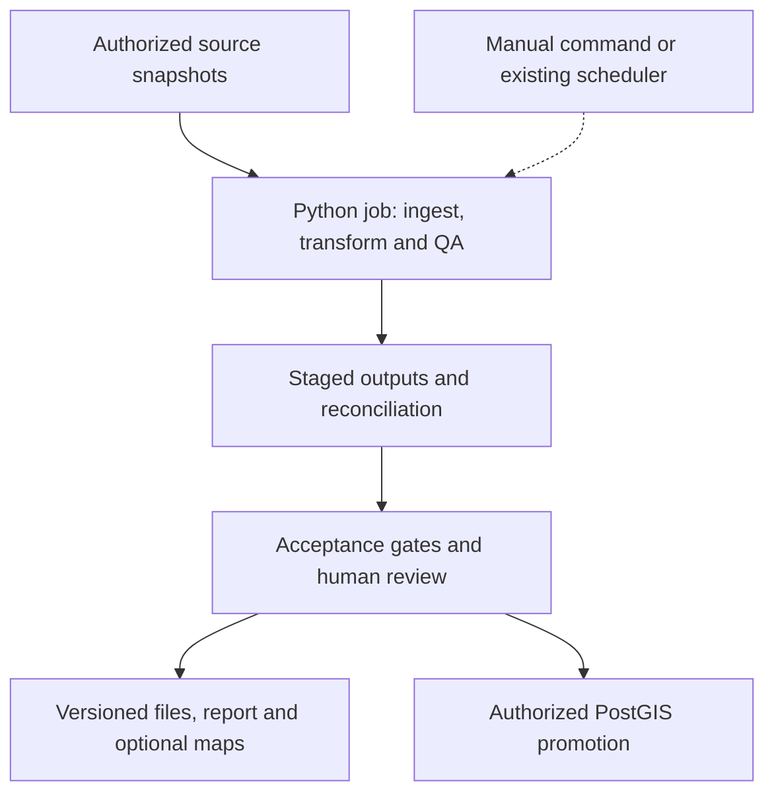

# GIS automation pilot: tooling and delivery standard

Reviewed November 15, 2026. Proposed ZQM Computing delivery guidance.
Use with the [offer playbook](gis-workflow-automation-offer-playbook.md),
[source/QA checklist](pipeline-source-qa-checklist.md) and
[engagement templates](workflow-engagement-scope-templates.md).

**Default:** one documented Python job, explicit input/output contracts and
runtime QA. Add DuckDB for useful SQL transformations, GDAL for format/driver
requirements, and PostGIS for an agreed shared database target. A file-only
pilot can finish at GeoPackage or GeoParquet without a server. Select components
after profiling representative data; performance claims require measurements.

This is an implementation standard, not evidence that a complete combined
pipeline has been delivered. Repository component evidence and its limits
are recorded in the offer playbook. Existing proposed prices remain in
[the repository README](../../../README.md).

## 1. Select the smallest sufficient stack

| Need | Default / addition | Decision and boundary |
| --- | --- | --- |
| Vector transformations | GeoPandas, Shapely and PyProj | Readable Python; explicit geometry, CRS, units and axis-order rules. Profile memory and representative volume. |
| Local analytical SQL | DuckDB Spatial | Add for joins, aggregation or file analytics that benefit the workflow. Record engine and extension versions; do not assume every SQL function matches PostGIS. |
| Format conversion | GDAL/OGR | Add required drivers and verified conversion/reprojection commands. Reopen outputs and check schema, CRS, geometry and values. |
| Shared persistent spatial store | PostgreSQL/PostGIS | Use an authorized client database when transactions, shared access or governed persistence are required. Scope roles, ownership, backups and recovery explicitly. |
| Runtime validation | Explicit Python checks and SQL constraints | Raise exceptions or return a failing status for blocking findings; keep reason-coded rejects and reconciliation. |
| Larger validation framework | Great Expectations or the client's existing framework | Add only for a demonstrated rule-management/reporting need. Geometry, CRS and spatial semantics still need explicit checks. |
| Invocation and scheduling | Documented manual command; existing cron/task scheduler when needed | A scheduler controls the job. Scheduled operation needs an owner, non-overlap control, timeout, logs and a tested failure/retry policy. |
| Orchestration | Existing client platform; consider Prefect or Dagster when justified | Dependencies, multiple jobs or operational visibility can justify it. Airflow is reasonable in an established client environment; a new platform is a separate scope. |
| Maps and handoff | GeoPackage/GeoParquet plus report; QGIS layouts when maps are required | Match the buyer's actual output and software. Add Folium, Altair or MapLibre only when the requested delivery needs them. |
| Client-specific bridge | FME or ArcPy | Use authorized client licensing and demonstrated task competence. An integration does not establish ArcGIS Enterprise administration or Utility Network migration experience. |

DuckDB's usual embedded database-file mode supports read/write access from
one process, including multiple writer threads within that process. Treat
multiple writers in different processes as a separate architecture decision;
do not share a writable embedded file casually. Other DuckDB deployment modes
have different concurrency arrangements. [S1]

## 2. Data flow and job control

The Python job may use GeoPandas, GDAL and DuckDB internally. PostGIS is an
optional publication target, and report/map generation uses the accepted
snapshot. The scheduler does not sit between the database and the report as
a data-conversion step. No scheduler or hosting subscription is implied.

For database delivery, validate staging tables before an explicitly authorized
promotion, use transactions where applicable, and test rollback/replay.
Constraints and an index do not establish permissions, backup quality or
operational ownership. Record those responsibilities in the handoff.

For multiple output files, stage and validate the complete set, then publish
a versioned release with a completion manifest using a tested release protocol.
Separate file replacements are not one transaction; consumers must know how
to identify the complete accepted release and retain the prior good release.

## 3. Spatial correctness and failure behavior

| Control | Required implementation decision |
| --- | --- |
| CRS assignment versus transformation | Assigning a CRS describes existing coordinates; transformation changes them. Require a verified source CRS before transforming. An SRID label alone cannot validate coordinate meaning. [S2] |
| Measurements | Choose an appropriate projected or geodesic method, record units and area of use, and test known distances/areas. Do not interpret degrees as metres. |
| Transformation quality | Record the selected operation, axis order, PROJ/database versions and required grids. Missing grids or an unsuitable operation can reduce accuracy; block or disclose under an approved rule. [S3] |
| DuckDB spatial behavior | Pin and test the engine/extension combination, transformation options and coordinate order. Current documentation may describe behavior different from an older cookbook environment. [S4] |
| Geometry repair | Preserve original geometry and IDs, stage repairs, and compare geometry type, part counts and relevant measurements. `ST_MakeValid` can produce collections or lower-dimensional results; validity alone does not establish suitability. [S5] |
| Schema enforcement | Define required/non-null fields, keys, domains and allowed geometry/SRID. Test wrong values and nulls; SQL checks need deliberate null handling. |
| Runtime QA | Use explicit failure paths. Python `assert` statements may be removed by `-O`; they are suitable for tests, not the sole publication gate. [S6] |
| Replay and retries | Define replace/upsert/append behavior, batch identity and duplicate policy. Retry only safe operations; external effects and partial failure need explicit recovery. |

Use the [source/QA checklist](pipeline-source-qa-checklist.md) to record the
actual acceptance rule and evidence. A completed process, a zero exit code
and a file on disk do not independently prove an acceptable dataset.

## 4. Desktop location-screening additions

| Addition | Delivery rule |
| --- | --- |
| Census TIGER/Line and ACS | Treat boundaries and demographic estimates as separate sources. Match geography/vintage and GEOIDs, preserve leading zeros, and retain ACS margins of error and estimate periods. Comparisons must consider uncertainty. [S7, S8] |
| OpenStreetMap / OSMnx | Record extract date, coverage, tags, attribution and reuse terms. Observed POIs are not a complete business census; missing features remain uncertain. |
| H3 | Use for an explicit aggregation purpose and test resolution sensitivity. Cells at the same resolution have different areas; normalize density using actual relevant area or a justified population/exposure denominator. H3 does not make comparisons automatically fair. [S9] |
| Routing / drive time | Select a supported engine/profile and current network snapshot. Validate snapping, unreachable pairs, units, mode and traffic assumptions; an ordinary shortest-distance graph is not a validated drive-time model. |
| OSRM tables | Durations describe fastest routes under the selected profile; associated route distances are not necessarily shortest distances. Unreachable or estimated fallback cells need distinct treatment. A matrix is not an isochrone polygon. [S10] |
| Public routing demos | Check the endpoint's usage/privacy policy before use. Do not assume production capacity or an SLA; restricted coordinates require authorized handling. Self-hosting also has compute and maintenance costs. [S11] |
| Commercial enrichment | Client-funded, explicitly licensed data only; confirm analysis, redistribution and report rights before quoting. Do not absorb an unspecified data subscription in a fixed-price pilot. |
| Site scoring | Agree criteria, weights, exclusions, missing-data rules and sensitivity tests. Report a desktop decision aid with uncertainty; do not imply predicted sales or a professionally certified suitability finding. |

## 5. Environment and handoff

Use a tested supported Python/tool combination with locked direct and transitive
dependencies. `requirements.txt` or `environment.yml` is a filename, not proof
of a lock: record resolved versions and, where supported, artifact hashes.
Capture native GDAL, GEOS, PROJ and driver versions, OS/architecture, extension
versions and transformation resources. Verify installation and a representative
run in the intended target environment. [S12]

Docker is optional. If used, record the image digest and platform as well as
the build recipe; secrets and client datasets stay outside the image. Pinning
does not replace an update/security review. Git records code/configuration
revisions; the source register and run manifest identify data revisions.

Handoff includes the command, configuration reference, input/output schema,
source register, run/QA report, recovery instructions, dependencies and a named
operator. Scheduling, maintenance and support are separate agreed responsibilities.

## 6. Implementation order and evidence gates

| Priority | Next reusable implementation | Evidence required before claiming completion |
| --- | --- | --- |
| 1 | One bounded GeoPandas/DuckDB pilot, with an optional PostGIS adapter | Pinned runtime; representative golden input; reopened output; source/target value reconciliation; failure, replay and recovery evidence. Existing components are not proof of the integration. |
| 2 | Apply the shared source/QA checklist | Completed source entries, licensed coverage, explicit QA thresholds and reviewer signoff for the actual run. This document supplies the checklist, not a completed client register. |
| 3 | Reuse the QGIS exhibit structure for location screening | Keep the Atlas presentation pattern, then implement and test a location-specific data adapter, legend, scoring/uncertainty labels, inset, manifest and PDF output. |
| 4 | Add a cookbook pilot walkthrough after the adapter exists | Exact commit, reproducible fixture, install/run instructions, expected results, negative cases and clean-environment verification. Publish claims only for the demonstrated target. |

The [QGIS Atlas implementation](https://github.com/ZQM-Computing/qgis-resources/blob/5f958056d933e0bdc1b21484a9cfff9681774577/exhibit-production/README.md)
currently documents the environmental `wetland_inventory` and `flood_hazard`
adapter. It is useful cartographic evidence, but it does not yet prove a generic
location-scoring adapter. Reuse its title, overview, scale, source and manifest
structure after validating the new domain content and disclaimer.

## Official references

Reviewed November 15, 2026. Moving documentation describes current tools;
every delivery must record and test its actual versions.

- **[S1]** [DuckDB concurrency](https://duckdb.org/docs/current/connect/concurrency).
- **[S2]** [GeoPandas projections](https://geopandas.org/en/stable/docs/user_guide/projections.html).
- **[S3]** [PyProj transformation grids](https://pyproj4.github.io/pyproj/stable/transformation_grids.html).
- **[S4]** [DuckDB spatial functions](https://duckdb.org/docs/current/core_extensions/spatial/functions) and [DuckDB 1.5 spatial changes](https://duckdb.org/2026/03/09/announcing-duckdb-150).
- **[S5]** [PostGIS ST_MakeValid](https://postgis.net/docs/ST_MakeValid.html).
- **[S6]** [Python command-line options](https://docs.python.org/3.12/using/cmdline.html), `-O`.
- **[S7]** [Census TIGER/Line files](https://www.census.gov/geographies/mapping-files/time-series/geo/tiger-line-file.html).
- **[S8]** [Census guidance on comparing ACS estimates and margins of error](https://www.census.gov/help/topics/faq.do-i-need-to-consider-the-margins-of-error-when-comparing-acs-estimates.html).
- **[S9]** [H3 cell statistics](https://h3geo.org/docs/core-library/restable/).
- **[S10]** [OSRM HTTP API](https://project-osrm.org/docs/v26.4.0/http), Table service.
- **[S11]** [OSRM demo usage/privacy notice](https://test.project-osrm.org/about.html). Search-indexed notice inspected; direct retrieval returned 502 during review. Recheck the actual endpoint policy before use.
- **[S12]** [pip repeatable installations](https://pip.pypa.io/en/stable/topics/repeatable-installs/).
